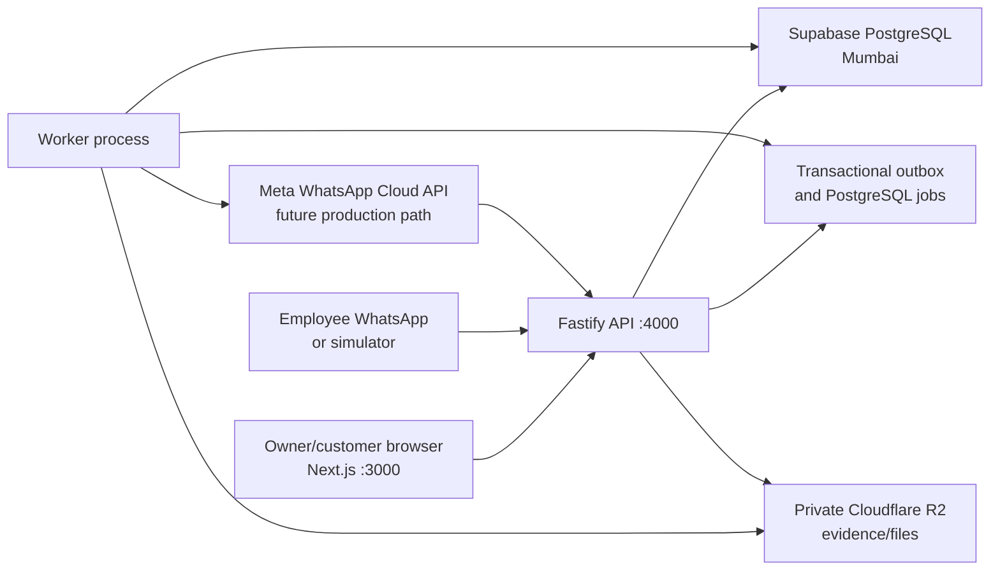

# ExtraWork — Current Project Handoff

**Handoff date:** 17 August 2026  
**Repository:** `/Users/vedantsacheendran/Desktop/MFC/extrawork`  
**Current branch:** `main`  
**Baseline commit:** `0110419` (`Full pre-WhatsApp backup`)  
**Audience:** the next engineer/agent continuing the project with no chat history

This document supersedes `docs/HANDOFF.md` as the current handoff. The older
file remains useful history, but its status table and next steps describe an
earlier stage before the complete simulator, intake service, owner UI, hosted
storage migration, authentication additions, and recent performance fixes.

No secrets are included here. Read values from the local `.env` without copying
them into chat, source control, screenshots, logs, or documentation.

---

## 1. Executive summary

ExtraWork is a WhatsApp-first approval and evidence system for Indian
construction businesses. A site employee sends a short WhatsApp message about
additional work. ExtraWork verifies that the sender is an authorised employee,
resolves the project, validates the cost and schedule impact, creates a formal
change request, and sends the customer a private approval link. The customer
can approve, decline, or request a revision without creating an account. The
owner sees everything in a web dashboard and receives an evidence trail suitable
for substantiating the extra work later.

The product is currently a working local pilot backed by hosted Supabase
PostgreSQL and private Cloudflare R2 object storage. The owner dashboard,
employee WhatsApp simulator, customer approval page, database, worker, evidence
pipeline, authentication UI, test account, and most business rules exist.

The next major milestone is replacing the simulator with the real Meta WhatsApp
Cloud API and hosting the web/API/worker processes publicly. The current Cloud
API adapter is only partial and must not be treated as production-ready.

### Current status

| Area                                               | Status                                              |
| -------------------------------------------------- | --------------------------------------------------- |
| Owner website/dashboard                            | Working locally                                     |
| Account registration and password sign-in          | Working locally                                     |
| Google sign-in implementation                      | Built; only shown when credentials are configured   |
| Projects, customers, employees and permissions     | Working                                             |
| Employee WhatsApp message parser and intake policy | Working                                             |
| WhatsApp employee/customer simulator               | Working                                             |
| Customer approval/decline/revision page            | Working                                             |
| Typed customer-name verification                   | Working                                             |
| Audit history, evidence snapshots and PDFs         | Working                                             |
| PostgreSQL data store                              | Hosted on Supabase in Mumbai                        |
| Object/file storage                                | Private Cloudflare R2 bucket, APAC placement hint   |
| Application hosting                                | Still local; not publicly deployed                  |
| Real WhatsApp outbound templates                   | Not implemented                                     |
| Real WhatsApp inbound employee messages            | Not implemented                                     |
| Meta Business/WABA configuration                   | Not started beyond planning                         |
| Production authentication provider                 | Not finalised; local auth is rejected in production |

---

## 2. Product intent and actors

### Business owner

The construction-company owner uses the website to:

- register and sign in;
- create and manage customer records and authorised approver contacts;
- create projects and record original contract baselines;
- add employees by WhatsApp phone number;
- decide which projects each employee may raise requests for;
- set an employee's maximum request amount;
- view every accepted and rejected inbound employee message;
- view projects, change requests, decisions, reports, audit history and evidence;
- edit the customer-facing request template, excluding locked assurance copy.

### Employee

The employee does not need an account or app. Their phone number is their
identity for intake. They message the ExtraWork WhatsApp number and receive a
reply explaining whether the request was accepted or what must be corrected.

Supported labelled form:

```text
Project: Tower 4
What: Two extra power points in the kitchen
Why: Client changed the appliance layout
Cost: 15800
Days: 2
```

Supported comma-separated form:

```text
Tower 4, Two extra power points, Client changed the layout, 15800, 2
```

The CSV-like form is parsed from both ends:

- first value: project;
- second value: what is being done;
- last value: days;
- second-to-last value: cost;
- everything remaining in the middle: reason, including embedded commas.

The parser tolerates extra spaces, Indian money formats, `₹`, comma grouping,
`k`, `lakh`/`lac`, and common day formats. It refuses ambiguous costs such as
`15-20k`. It also refuses near-miss projects: `Tower 45dffds` must not match
`Tower 4` simply because both contain the word “Tower”.

### Customer

The customer receives a private, expiring request URL and needs no account.
They can:

- read the project, scope, explanation, cost and schedule impact;
- approve;
- decline;
- ask for a revision;
- complete OTP verification when the assurance level requires it;
- enter their full name as the signature;
- receive a receipt reference after deciding.

The server compares the entered name with the recorded authorised customer
contact. A different person's name is rejected. A drawn-signature canvas is not
currently implemented; the signed evidence is the verified typed name plus the
other recorded evidence.

---

## 3. Agreed product sequence

The founder's required order remains:

1. Build the owner-facing website and backend.
2. Simulate the employee and customer WhatsApp experience.
3. Connect owner, employee and customer views into one working product.
4. Migrate data and file storage off the local machine.
5. Integrate the real WhatsApp Business Platform.

Steps 1–4 are substantially complete. Work is now at step 5, with public
application hosting and production authentication also required before a real
pilot can go live.

---

## 4. Architecture and framework

ExtraWork is a TypeScript pnpm monorepo and modular monolith. It runs as three
separate processes sharing one PostgreSQL database and one domain model.



### Runtime applications

| Application   | Technology                     | Responsibility                                                                                 |
| ------------- | ------------------------------ | ---------------------------------------------------------------------------------------------- |
| `apps/web`    | Next.js 15.1.4, React 19       | Owner dashboard, authentication pages, simulator, public customer approval pages               |
| `apps/api`    | Fastify 5.2.1                  | Business API, public approval API, simulator endpoints, provider webhooks                      |
| `apps/worker` | TypeScript worker + Playwright | Outbox processing, message delivery, jobs, reminders, evidence/PDF generation, integrity tasks |

### Shared packages

| Package                  | Responsibility                                                                                                    |
| ------------------------ | ----------------------------------------------------------------------------------------------------------------- |
| `packages/contracts`     | Zod schemas, API contracts, error catalogue, events and assurance wording                                         |
| `packages/domain`        | Money, tax, state machine, intake parsing/matching, tokens, identity helpers, canonical snapshots and audit rules |
| `packages/application`   | Use cases for auth, projects, change requests, employees, intake, approvals, evidence and files                   |
| `packages/db`            | Drizzle/PostgreSQL schema, migrations, repositories, outbox, jobs, rate limits and maintenance tools              |
| `packages/integrations`  | WhatsApp, email, OTP, payment and webhook adapters                                                                |
| `packages/files`         | Local and S3-compatible object stores, validation and quarantine/scanning                                         |
| `packages/runtime`       | Dependency composition root used by API, worker, scripts and tests                                                |
| `packages/observability` | Structured logs, redaction, metrics and request IDs                                                               |
| `packages/testkit`       | Seed data, fixtures and PostgreSQL test harness                                                                   |

### Core versions

- Node.js `>=20.11.0`
- pnpm `11.21.0`
- TypeScript `5.7.3`
- Next.js `15.1.4`
- React `19.0.0`
- Fastify `5.2.1`
- PostgreSQL `16`
- Drizzle ORM `0.38.3`
- Zod `3.24.1`
- Vitest `2.1.8`
- Playwright `1.49.1`

---

## 5. Implemented owner-facing product

The web application includes:

- a logged-out home page with sign-in and registration entry points;
- account registration;
- password sign-in;
- magic-link sign-in for the local/self-hosted driver;
- conditional Continue with Google support;
- onboarding and organization setup;
- dashboard summary;
- projects list, project creation and project detail;
- original project baseline values and change register;
- customers directory and authorised contacts;
- employees and project permissions;
- inbound request log, including rejected attempts;
- change-request detail and owner actions;
- request-template settings;
- reports;
- customer approval and receipt pages;
- an integrated WhatsApp simulator.

Important fixes already made:

- customer list results now use a dedicated summary contract instead of
  pretending to be full customer records;
- project creation accepts human-formatted Indian phone numbers and normalises
  them before storage;
- a new customer creation response returns the default approver contact ID so
  the project can be created against a real authorised contact;
- the project form omits empty optional contact fields and shows useful
  validation details;
- the API root now returns a discovery/status document instead of a confusing
  `NOT_FOUND` response.

---

## 6. Employee intake and WhatsApp simulator

The simulator is not a mock business flow. It injects a simulated WhatsApp
message into the real intake application service. The same parser, employee
lookup, project matching, permissions, amount ceiling, change-order creation,
snapshot freezing, outbox and worker delivery path are exercised.

The development-only API routes are:

```text
POST /webhooks/v1/simulator/whatsapp
GET  /webhooks/v1/simulator/employees
GET  /webhooks/v1/simulator/outbox
```

They only exist when:

```dotenv
APP_ENV=local
WHATSAPP_DRIVER=simulator
```

Production configuration rejects the simulator because its inbound endpoint is
deliberately unsigned and can impersonate any configured employee number.

The intake service currently handles:

1. global employee lookup by normalised phone number;
2. tenant derivation from the employee record;
3. duplicate provider-message replay protection;
4. labelled and comma-separated parsing;
5. project assignment and fuzzy matching;
6. strict refusal of ambiguous/near-miss project names;
7. missing or ambiguous field replies;
8. employee amount ceilings and project-state policy;
9. change request and line-item creation through existing services;
10. canonical version freezing and customer-send scheduling;
11. logging accepted and rejected messages for owner review.

---

## 7. Customer message and approval rules

The current customer request copy generated by the application is conceptually:

```text
Hi <customer>, <company> has requested your approval for additional work on <project>.

Additional amount: <amount>

Review the full details and approve, decline, or ask for a change:
<private link>

This link is only for you and works until <actual expiry date>. It never asks
for payment, card details, an OTP, or any account login.

Call us on <company phone> if you have any questions.
```

The expiry sentence uses the request's actual expiry timestamp rather than a
hard-coded “one week” claim. The standard default is seven days.

The amount/schedule summary wording was changed to read naturally:

```text
It adds ₹<cost> to the cost and <days> days to the schedule.
```

The request message intentionally includes customer, company and project
context because an unexpected message about money and a link can resemble
fraud. It explicitly says what the link will never request and includes the
company's own phone number as an independent verification channel.

---

## 8. Data, storage and infrastructure decisions

### PostgreSQL

The authoritative transactional store is Supabase PostgreSQL in the Mumbai
region. It contains organizations, users, password hashes for the current local
auth driver, memberships, sessions, customers, contacts, projects, employees,
assignments, change requests, immutable versions, decisions, messages, inbound
messages, audit events, outbox rows, jobs, file metadata and rate-limit state.

There are currently eight migrations:

```text
0001_core_schema.sql
0002_search_and_projections.sql
0003_append_only_evidence.sql
0004_cancelled_draft_constraints.sql
0005_whatsapp_intake.sql
0006_intake_without_user.sql
0007_simulator_message_channel.sql
0008_password_and_oauth_identities.sql
```

Important hosted-database safeguards:

- SSL certificate verification remains enabled using the Supabase CA;
- migrations work with Supabase's extension schema;
- the destructive test harness refuses non-local or non-`*_test` databases;
- reset and maintenance commands contain environment guards;
- production should use a restricted runtime role, with a separate maintenance
  connection for repair operations;
- the worker requires transaction semantics compatible with
  `FOR UPDATE SKIP LOCKED`, so the transaction pooler must not be used.

### Cloudflare R2

Files and evidence artifacts use a private Cloudflare R2 bucket through its
S3-compatible API. The bucket was selected because the free tier provides 10 GB
and avoids egress charges that would apply when evidence files are repeatedly
downloaded.

The bucket has an APAC placement hint. This is not a guarantee that every byte
remains specifically inside India. Supabase is in Mumbai; R2 is regional/APAC.
Whether strict India-only storage is legally required for a production client
still needs a fact-specific legal/privacy review.

Objects must remain private. The application serves them through short-lived
signed URLs.

### Application hosting

Only the stores are hosted. The Next.js web app, Fastify API and worker still
run on the developer's Mac. A public HTTPS deployment has not been selected or
completed. This blocks real Meta webhook delivery.

---

## 9. Authentication

Implemented methods:

- email/password registration and sign-in;
- local email magic-link flow;
- direct Google OAuth with state and PKCE when Google credentials are present;
- HTTP-only session cookies;
- separate readable CSRF cookie echoed in the `X-CSRF-Token` header;
- account-enumeration-resistant registration and sign-in responses;
- membership, role, project-grant and subscription checks.

The current known local test account can be created with:

```bash
pnpm db:test-account
```

Its development defaults are:

```text
email: test@gmail.com
password: Test123
```

This intentionally weak test credential must never be created in production.
The script refuses `APP_ENV=production`.

Production configuration also rejects `AUTH_DRIVER=local`. Before launch,
choose and finish a managed production authentication path—Supabase Auth is the
natural candidate because Supabase is already in use—or deliberately redesign
and security-review the first-party auth posture.

---

## 10. Security and evidence invariants

Do not weaken these rules:

1. Money uses integer minor units, never floating point.
2. Quantities use decimal strings where precision matters.
3. A sent version is immutable; amendments create a new version and revoke old
   approval tokens.
4. Decisions, audit events, project projections and outbox events commit in one
   transaction.
5. External provider calls never occur inside domain transactions.
6. Approval tokens are high-entropy, stored hashed, scoped and expiring.
7. Tenant-owned repository operations require a tenant context.
8. Cross-tenant identifiers return `NOT_FOUND`, not an existence-revealing
   authorization error.
9. Decisions and audit evidence are append-only and protected by database
   constraints/triggers and restricted roles.
10. Provider webhook signatures are checked against raw request bytes before
    parsing or persistence.
11. Raw provider events are retained and unknown event shapes are surfaced
    rather than silently discarded.
12. Logs and metrics must not contain approval tokens, full phone numbers,
    credentials, signatures or other sensitive fields.

Assurance level A0 is the default secure-link/typed-name record. A1 adds OTP to
the recorded approver's phone. A2 licensed e-signature is not implemented and
must never be implied by the product copy.

---

## 11. Performance investigation and changes

After the Supabase migration, login and navigation became much slower. The
local API process itself responded quickly; the dominant problem was repeated
network round trips from the developer machine to the Mumbai database, made
worse by cold TLS connections and sequential queries.

The following optimisations are now implemented:

- database pool minimum, idle timeout and connection timeout are configurable;
- baseline PostgreSQL connections are opened before the API accepts traffic;
- TCP keepalive is enabled;
- one authentication projection resolves session, organization, membership,
  subscription and project grants in a single database round trip;
- authentication is cached on the Fastify request so rate-limit hooks and route
  handlers do not authenticate twice;
- known password users use one statement to touch the profile, select the
  default organization and create a session;
- local authenticated reads use an in-memory rate limiter instead of writing a
  remote PostgreSQL counter on every page view;
- independent dashboard and related-resource reads are parallelised;
- employee assignments and inbound request display names are projected without
  N+1 follow-up queries.

These changes reduce latency amplification but cannot remove the physical
distance between the local app and Mumbai. Deploying the API/worker near the
database is the proper structural fix.

---

## 12. Local development and testing

### Normal localhost testing

Open three terminal windows from the repository root. Do not place all three
commands on one shell line.

Terminal 1:

```bash
pnpm dev:api
```

Terminal 2:

```bash
pnpm dev:worker
```

Terminal 3:

```bash
pnpm dev:web
```

URLs:

```text
Owner website:       http://localhost:3000
WhatsApp simulator:  http://localhost:3000/simulator
API discovery:       http://localhost:4000/
API liveness:        http://localhost:4000/healthz
API readiness:       http://localhost:4000/readyz
```

`/healthz` proves the API process is alive but deliberately does not touch the
database. `/readyz` checks database connectivity and is the better test for a
usable stack.

### Phone/LAN testing

For owner, employee and customer views from another device on the same Wi-Fi:

```bash
pnpm dev:lan
```

This detects the Mac's LAN address, exports matching API/web/CORS variables for
that run, and starts all three processes. Approval links created during that run
use the LAN host. Old links that contain `localhost` will not work on a phone.

The browser API helper also replaces a compiled loopback API host with the LAN
hostname when appropriate. This fixed the simulator's false “API not running on
port 4000” error when the page was opened from another device.

### Useful commands

```bash
pnpm install
pnpm preflight:hosted
pnpm db:migrate
pnpm db:seed
pnpm db:test-account
pnpm typecheck
pnpm test:unit
pnpm test:integration
pnpm test:security
pnpm test:golden
pnpm test:e2e
pnpm verify
pnpm db:verify-chain
```

The older handoff records a successful full build/migration/seed and 287 tests
at that earlier checkpoint. More tests were subsequently added. The complete
suite was not rerun merely to write this document; run `pnpm verify` before the
next release or deployment decision.

---

## 13. Current real WhatsApp implementation gap

ExtraWork already has these Cloud API pieces:

- environment variables for phone number ID, access token, app secret and
  verify token;
- a Graph API outbound HTTP adapter;
- GET webhook challenge handling at
  `/webhooks/v1/meta/whatsapp`;
- raw `X-Hub-Signature-256` verification;
- webhook inbox persistence and asynchronous normalisation;
- delivery status handling for sent/delivered/read/failed events;
- template names reserved as `extra_work_request_v1`,
  `extra_work_reminder_v1` and `extra_work_decision_receipt_v1`.

However, it is not production-ready:

1. Outbound Cloud API sends currently use `type: text`, not approved template
   messages. A business-initiated customer request outside the 24-hour service
   window must use an approved template.
2. The reserved template constants are not used to build API payloads.
3. Inbound Meta `messages[]` events are not parsed into employee messages.
4. The worker only normalises message delivery statuses, not inbound employee
   content.
5. Real inbound media download is not connected to the evidence/file pipeline.
6. The Graph API version defaults to hard-coded `v21.0` and should be a
   validated configuration value set to Meta's supported version at deployment.
7. Meta cannot call a local or LAN webhook. The API needs a stable public HTTPS
   URL.

Do not switch `WHATSAPP_DRIVER=cloud-api` and declare the integration finished
until all seven points are addressed and exercised end to end.

---

## 14. Most recent WhatsApp Business decisions

### Ownership

For the first construction-company pilot, the recommended arrangement is:

- the construction client owns the Meta Business Portfolio;
- the client owns the WhatsApp Business Account and production number;
- the client retains at least one administrator;
- the developer is added as an administrator/developer;
- production assets are not placed under an unregistered disposable ExtraWork
  portfolio.

If ExtraWork later becomes a multi-customer SaaS, ExtraWork should establish its
own legal business identity, complete Meta business verification/app review,
and use Embedded Signup to onboard client-owned WABAs.

### Legal registration

A legally incorporated ExtraWork company is not required to use Meta's free
test number and sandbox. A legally verifiable business identity will be needed
for production verification and scaling. For the first pilot, using the
construction client's registered entity avoids forcing premature incorporation
of the software business.

This is operational guidance, not legal advice. Entity, privacy, consent, tax
and India data-residency requirements need advice appropriate to the actual
business and customers.

### Cost expectation

Direct Meta Cloud API access does not require a separate monthly platform
subscription. Meta charges for delivered messages by recipient market and
message category. The January 2026 India rate reviewed during this chat was
approximately ₹0.115 per delivered utility message. Therefore:

- 100 initial approval messages: about ₹11.50 before tax;
- 1,000: about ₹115 before tax;
- 10,000: about ₹1,150 before tax.

Each separately delivered utility reminder or receipt may incur another charge.
Rates can change and must be checked against Meta's current rate card before
pricing the product.

### Template to create

Proposed name and category:

```text
Name: extra_work_request_v1
Category: Utility
```

Proposed content:

```text
Hi {{1}}, {{2}} has requested your approval for additional work on {{3}},
with an additional amount of {{4}}.

Review the full details and approve, decline, or request a change here: {{5}}

This private link is available only to you and expires on {{6}}. It will never
ask for payment, card details, an OTP, or an account login. If you have any
questions, call {{2}} at {{7}}.
```

Variables:

1. customer name;
2. construction company name;
3. project name;
4. formatted amount;
5. approval link;
6. expiry date;
7. company phone number.

A URL button labelled **Review request** may be preferable if Meta accepts a
fixed domain/path plus dynamic token suffix. Align the API payload with the
exact template Meta approves; do not let code and approved copy drift.

### Exact onboarding point reached

No Meta app, WABA, real number, permanent token, template or webhook has been
created yet in this continuation. The browser was left on Meta Business login.

The immediate instruction given was:

1. sign in using a genuine personal Facebook profile as the administrator
   identity;
2. do not create a fake Facebook profile named ExtraWork;
3. enable two-factor authentication;
4. use Meta's development/test path first;
5. do not enter unverified legal-business claims or expose secrets in chat.

---

## 15. Clear next steps

### Immediate: Meta test setup

1. Log in to Meta Business/Meta for Developers with the developer's real
   personal Facebook profile and enable 2FA.
2. Create or select a development Business Portfolio without pretending that
   ExtraWork is already a registered entity.
3. Create a Meta developer app using the WhatsApp/business messaging use case.
4. Add the WhatsApp product.
5. Use Meta's temporary test number and temporary token.
6. Add a personal WhatsApp number as an approved test recipient.
7. Send Meta's standard `hello_world` test template.
8. Record the test WABA ID and Phone Number ID, but do not paste tokens or app
   secrets into chat.

### Engineering required before real end-to-end WhatsApp

1. Add a configurable supported Meta Graph API version.
2. Extend the outbound message contract to support template name, language,
   body parameters and URL-button parameters.
3. Send `extra_work_request_v1` as a Utility template.
4. Add reminder and decision-receipt templates or explicitly keep those inside
   valid service windows/fallback channels.
5. Parse inbound Meta `messages[]` webhooks, beginning with text messages.
6. Normalise sender phone, provider message ID, text and media metadata into the
   existing intake input.
7. Route real inbound messages through `IntakeService.handleInbound`.
8. Download inbound media safely into the private file/quarantine pipeline.
9. Retain raw events, signature verification, deduplication and rapid 200
   acknowledgement.
10. Add unit, integration, forged-webhook, duplicate-delivery and end-to-end
    tests.

### Public deployment

1. Select public hosting for Next.js, Fastify API and the continuously running
   worker.
2. Place API and worker close to Supabase Mumbai when possible.
3. Configure stable HTTPS domains for web and API.
4. Move all secrets into the hosting providers' encrypted secret managers.
5. Configure CORS, secure cookies, trusted proxy behavior and production-safe
   drivers.
6. Verify `/healthz`, `/readyz`, worker queue processing, R2 signed URLs and one
   complete evidence PDF.
7. Configure Meta's callback as:

   ```text
   https://<public-api-domain>/webhooks/v1/meta/whatsapp
   ```

8. Subscribe the app/WABA to the `messages` webhook field.

### Production Meta assets

1. Confirm the first construction client's legal entity and ownership.
2. Create the production WABA under that client's Business Portfolio.
3. Obtain a dedicated number capable of SMS or voice verification and not
   currently registered to another WhatsApp account.
4. Verify the number and preserve its six-digit registration PIN.
5. Submit and obtain approval for the Utility templates.
6. Complete business verification when Meta requests it.
7. Create a system user and permanent access token with the minimum required
   WhatsApp messaging/management permissions.
8. Add a payment method if required by the WABA billing flow.
9. Store `WHATSAPP_PHONE_NUMBER_ID`, `WHATSAPP_ACCESS_TOKEN`,
   `WHATSAPP_APP_SECRET` and the self-generated `WHATSAPP_VERIFY_TOKEN` only in
   deployment secrets.

### Pilot acceptance test

Test all three points of view:

1. **Owner:** sign in, create customer/project/employee and inspect request.
2. **Employee:** send valid, malformed, ambiguous, unauthorised, over-limit and
   duplicate WhatsApp messages.
3. **Customer:** receive template, open link, verify identity, approve/decline/
   request revision and obtain receipt.
4. Confirm owner dashboard status, employee reply, delivery status, customer
   decision, audit events, PDF evidence and R2 object.
5. Repeat on desktop and phone, then repeat with temporary provider/network
   failures to verify retries and idempotency.

---

## 16. Open decisions and risks

- Which public hosting provider/topology should run web, API and worker?
- Should production authentication use Supabase Auth, another managed provider,
  or a reviewed first-party implementation?
- Is OTP/A1 required by default or only for higher-risk requests/plans?
- Is typed-name signing sufficient for the first pilot, or is a drawn-signature
  experience required despite not changing the legal assurance class?
- Does the first client require strict India-only object storage rather than R2
  APAC placement?
- What exact customer opt-in language and records are required for the client's
  WhatsApp messaging practice?
- Who owns support, credential rotation, backup restore drills, alerting and
  incident response during the pilot?
- Meta template approval can reject or reclassify wording; approved copy and
  code parameters must be kept in sync.
- Local development against remote Mumbai PostgreSQL will remain slower than a
  co-located deployment even after query optimisation.

---

## 17. Repository and documentation notes

- `0110419` is the full pre-WhatsApp backup commit and is the safe baseline for
  the state documented here.
- `docs/HANDOFF.md` is historical and should not be used as the current status
  without this document.
- `README.md` contains general setup and architecture.
- `docs/IMPLEMENTATION_PLAN.md` contains requirement traceability.
- `infra/runbooks/hosted-migration.md` documents Supabase and R2 configuration.
- `infra/runbooks/` contains backup, restore, repair, access, credential and
  incident-oriented procedures.
- `graphify-out/graph.html` is the interactive architecture graph.
- `graphify-out/GRAPH_REPORT.md` and `graphify-out/graph.json` support scoped
  Graphify queries.

After changing source files, run:

```bash
graphify update .
```

---

## 18. Suggested prompt for the next chat

Copy this into the new chat:

```text
Read /Users/vedantsacheendran/Desktop/MFC/extrawork/docs/HANDOFF_2026-08-17.md
and use the existing graphify-out knowledge graph before inspecting raw files.
Confirm the current git status and commit. Do not assume the real WhatsApp Cloud
API integration is complete: outbound approved templates, inbound Meta message
parsing, public HTTPS hosting and production authentication are still pending.

Resume by walking me through the Meta WhatsApp test-account setup one screen at
a time. Once the Meta test app exists, implement the remaining Cloud API adapter
and inbound webhook path, verify it with tests, and keep all credentials out of
chat and source control.
```
