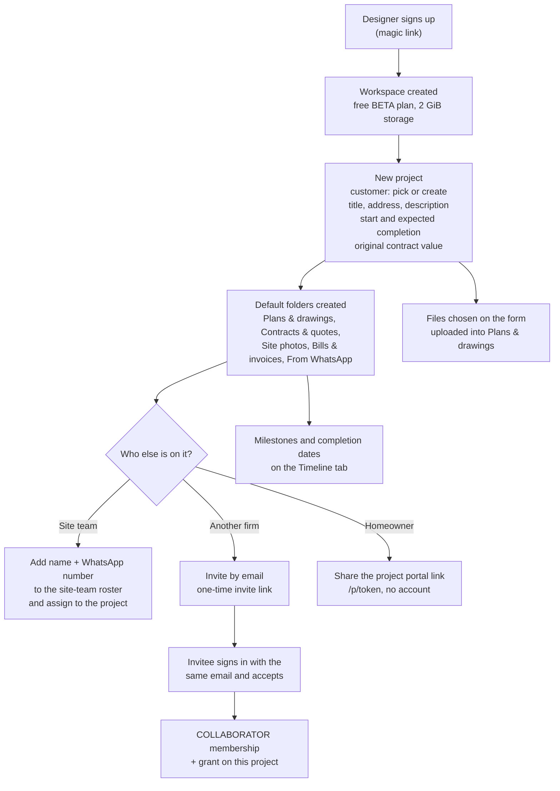
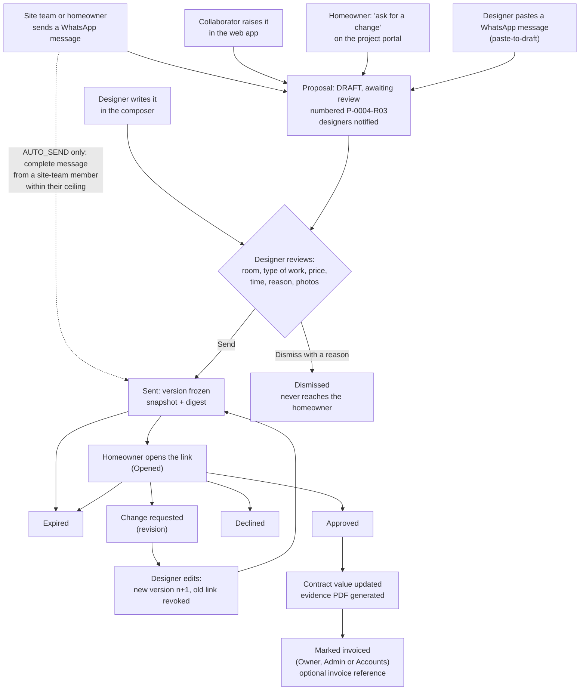
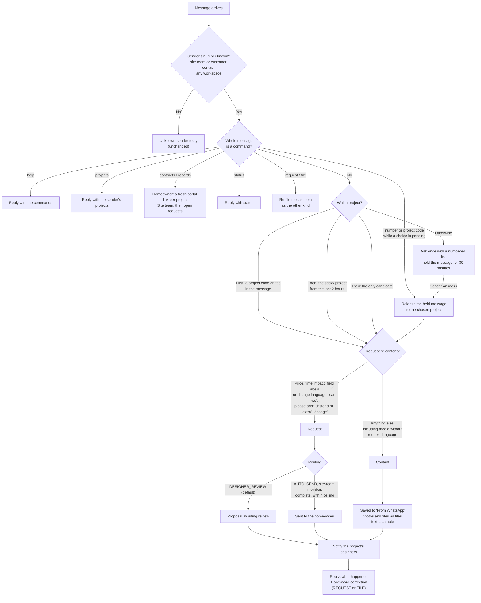

# ExtraWork workflows

_October 2026. Source of truth: the approved design,
[`superpowers/specs/2026-10-12-three-party-workspace-design.md`](superpowers/specs/2026-10-12-three-party-workspace-design.md)
(decisions D1 to D15). This document draws that design as flows; where the spec
does not decide something, it says "to be decided" rather than guessing._

ExtraWork is the working name. Every project has three parties: the **designer
or architect** (the primary user, whose workspace the project lives in), the
**construction company**, and the **homeowner**. Everything goes through the
designer: other people raise requests and send files, and only the designer
changes the record (D3, D4).

## Contents

- [Starting a project](#starting-a-project)
- [The change-request lifecycle](#the-change-request-lifecycle)
- [WhatsApp message handling](#whatsapp-message-handling)
- [Each role's point of view](#each-roles-point-of-view)
- [Responsibilities (RACI)](#responsibilities-raci)
- [Open questions](#open-questions)

---

## Starting a project

A designer signs up, gets a workspace on the free `BETA` plan (D13), and creates
a project. The project starts with its default folders; the people come next.
Site staff need only a WhatsApp number. People from other firms get an email
invitation and an account. The homeowner gets a link.

Notes:

- The original contract value is the baseline. As before, it locks once the
  first change is sent; changing it afterwards is an explicit, audited baseline
  amendment, and the project's contract history shows every amendment and every
  approved change with a running total.
- An invitation is accepted only by a signed-in user whose email matches. A
  collaborator who has no workspace of their own skips onboarding and lands in
  the designer's workspace (D1).
- A homeowner can also be invited as a collaborator (party `HOMEOWNER`) if the
  designer wants them to sign in; the default is the no-account portal (D5).
- Older projects get their default folders created the first time they are
  opened.

---

## The change-request lifecycle

A request can start in four places. Under the default routing
(`DESIGNER_REVIEW`, D3) every one of them waits for the designer, who completes
it and decides whether the homeowner sees it. A proposal is a DRAFT version with
review provenance (D4), so it may arrive without a price; the send gate still
applies before it can go out.

Step by step:

1. **Raised.** The origin is recorded on the version: `WHATSAPP`,
   `COLLABORATOR`, `PORTAL`, `PASTED` or `WEB`. Who raised it (a user, a
   site-team member or a customer contact) is kept with it.
2. **Numbered.** Request numbers carry the project number: `P-0004-R03` is the
   third request on project P-0004 (D8). Requests created before this change
   keep their old numbers.
3. **Reviewed.** The designer fills in what is missing: room, type of work,
   lines and price, time impact, justification. Room and type of work become
   part of the frozen record when present (D9). The designer can also dismiss a
   proposal with a reason; it is not sent.
4. **Sent.** Sending freezes the version exactly as before: canonical snapshot,
   SHA-256 digest, terms version, a single-use approval link stored as a hash.
5. **Decided.** The homeowner approves, declines or asks for a change from the
   request's approval link; their project portal shows every sent request and
   its status. The decision, its audit events and the project total commit in
   one transaction.
6. **Revised.** "Change requested" sends it back to the designer, who edits it
   into version n+1. The old link stops working.
7. **Invoiced.** An approved change can be marked as invoiced, with an optional
   invoice reference, by the owner, an admin or Accounts (D15). The mark is
   bookkeeping about the record, not part of it, and can be cleared.

The Requests screen sorts every request across projects into: Needs review,
Waiting on client, Approved, Declined, Change requested, Drafts, All.

**Under `AUTO_SEND`** (an organisation setting kept for firms that want the old
direct path), a complete WhatsApp request from a site-team member, within that
member's approval ceiling, is sent straight to the homeowner as it was before
this design. Anything incomplete, over the ceiling, or from anyone else still
becomes a proposal.

---

## WhatsApp message handling

One ExtraWork number. A sender writes one message with no syntax to learn; the
reply says what happened and offers a one-word correction (D6). Senders are
site-team numbers and homeowner (customer contact) numbers, across every
workspace, because the same foreman can be on two designers' rosters (D7).

The rules, in the order they apply:

1. **Identify** the sender by number. Unknown numbers get the existing
   unknown-sender reply.
2. **Commands** are whole-message words: `help`, `projects`, `contracts` or
   `records`, `status`, `request` or `file`, and a number or project code while
   a "which project?" question is pending.
3. **Project.** An explicit project code or title wins; then the project this
   sender used in the last two hours; then their only project; otherwise ask
   once with a numbered list and hold the message (and its media) until
   answered, for up to 30 minutes.
4. **Kind.** A message is a request if it carries a price, a time impact,
   request field labels, or change language. Otherwise it is content. We
   classify and offer a correction rather than asking "request or file?" every
   time, because asking adds the friction the notes warn against.
5. **Act.** Requests become proposals (or are sent, under `AUTO_SEND`, as
   described above). Content becomes documents in the project's "From WhatsApp"
   folder.
6. **Notify and reply.** The project's designers are notified of everything; the
   sender gets a reply naming what was done and the one word that reverses the
   classification.

Live WhatsApp is not connected yet (Meta account, templates and webhook are an
external blocker). These rules run today through the simulator.

---

## Each role's point of view

### Designer or architect (primary user)

**Channel:** the web app, on a laptop or a phone. Membership roles `OWNER`,
`ADMIN` or `PROJECT_MANAGER` (shown as **Designer**).

**Sees:** Overview, Projects, Requests, Timeline and Inbox; under Manage,
Customers, Site team and Reports; under System, Settings and the WhatsApp
simulator. Owners and admins see every project; a Designer (`PROJECT_MANAGER`)
sees the projects they are granted.

**Does:**

- Creates projects (customer, address, dates, contract value, drawings).
- Reviews every incoming request: completes, prices and sends it, or dismisses
  it with a reason. Only the designer edits or sends.
- Writes requests directly, or pastes a contractor's WhatsApp message to turn it
  into a proposal.
- Manages folders: renames, moves and deletes files; adds Drive, Dropbox,
  OneDrive or other https links (D12); chooses each folder's visibility
  (`INTERNAL`, `PROJECT`, `CLIENT`).
- Invites and removes collaborators; shares and revokes the homeowner portal
  link.
- Manages milestones; subscribes to the private calendar feed for reminders on
  their phone (D14).
- Reads the Inbox, which includes the WhatsApp message log.
- Sets notification preferences and, as owner or admin, the request routing.

### Construction company owner

**Channel:** the web app as a **collaborator** (party `CONSTRUCTION`) in the
designer's workspace, and WhatsApp if they are also on the site-team roster
(one person can be both, D2).

**Sees:** only Overview, Projects, Requests, Timeline and Inbox, and within
them only the projects they have been granted: the requests, the timeline and
the folders shared at `PROJECT` or `CLIENT` visibility. Not the customer list,
the site-team roster, reports, or `INTERNAL` folders such as Bills & invoices.

**Does:** raises requests for the designer's review, uploads files, adds links
and notes. Cannot edit, price, send or dismiss a request, or manage folders.
Milestones are read-only.

**Their own workspace:** a construction company can also run its own workspace
(business type `CONSTRUCTION` or `DESIGN_AND_BUILD`) and switch between it and
the designers' workspaces from the rail (D1). A firm that wants requests from
its site team to go straight to the homeowner can choose `AUTO_SEND`.

### Foreman or site employee

**Channel:** WhatsApp only. No account, no app. Their phone number is their
identity, and the same number can be on several designers' rosters (D7).

**Sees:** only what WhatsApp replies tell them: confirmation of what was saved
or raised, `projects`, and `contracts`/`records`, which for site staff lists
their open requests.

**Does:** sends one message (text, photos, a PDF) about a project. Change
language or a price makes it a request for the designer; anything else is saved
to the project's "From WhatsApp" folder. Answers "which project?" with a number
when asked; replies `REQUEST` or `FILE` to correct the last item.

### Homeowner

**Channel:** the project portal link (`/p/{token}`, no account, D5), the
approval link for each sent request (`/r/{token}`), and WhatsApp as a customer
contact.

**Sees on the portal:** the project summary, the contract value and its
history, every request that was sent to them and its status, evidence packs,
files in `CLIENT` folders (Plans & drawings, Contracts & quotes by default), and
milestones. Not proposals still with the designer, and not `PROJECT` or
`INTERNAL` folders.

**Does:** approves, declines or asks for a change on each sent request, from
its approval link; asks
for a new change from the portal ("ask for a change" becomes a proposal for the
designer); on WhatsApp, sends requests and files the same way the site team
does, and replies `contracts` to get a fresh portal link for each of their
projects.

### Collaborating architecture firm

**Channel:** the web app as a **collaborator** (party `ARCHITECT`; consultants
use `CONSULTANT`).

**Sees and does:** the same as the construction company collaborator above:
granted projects only; raise requests for review; upload files, links and
notes; read milestones. A firm that works with several designers switches
workspaces from the rail.

---

## Responsibilities (RACI)

### Who can do what (membership roles)

From the spec. "Designer" is the `PROJECT_MANAGER` role; "Accounts" is
`FINANCE`.

| Capability                                | Owner/Admin | Designer (PM) | Accounts | Viewer  | Collaborator |
| ----------------------------------------- | :---------: | :-----------: | :------: | :-----: | :----------: |
| See granted projects, requests, timeline  |     all     |    granted    |   all    | granted |   granted    |
| Raise a request for review (`propose`)    |      ✓      |       ✓       |          |         |      ✓       |
| Edit, price, send, dismiss a request      |      ✓      |       ✓       |          |         |              |
| Upload files, add links and notes         |      ✓      |       ✓       |          |         |      ✓       |
| Rename/move/delete files, manage folders  |      ✓      |       ✓       |          |         |              |
| Invite/remove collaborators, share portal |      ✓      |       ✓       |          |         |              |
| Milestones                                |   manage    |    manage     |   read   |  read   |     read     |
| Customers, site team roster, reports      |      ✓      | read/limited  |   read   |  read   |              |

Marking an approved change as invoiced belongs to Owner, Admin and Accounts.

### Each project's RACI

Each project's Team tab generates this matrix from the people actually on the
project. R = responsible, A = accountable, C = consulted, I = informed.

| Activity                        | Designer firm | Construction | Homeowner |
| ------------------------------- | :-----------: | :----------: | :-------: |
| Raise a change request          |       R       |      R       |     R     |
| Review, price and send it       |      A/R      |      C       |     I     |
| Approve, decline or revise      |       C       |      I       |    A/R    |
| Carry out the approved work     |       A       |      R       |     I     |
| Keep drawings and files current |      A/R      |      C       |     I     |
| Maintain the project record     |      A/R      |      I       |     I     |

---

## Open questions

The spec does not decide these. Each is **to be decided**:

- What happens to a held WhatsApp message when nobody answers "which project?"
  within 30 minutes.
- Whether the person who raised a proposal is told when the designer dismisses
  it, and through which channel.
- Which events, beyond the WhatsApp notifications above, notify which people,
  and which of them also send email.
- Localisation of WhatsApp replies and the portal ("Code in various" in the
  notes is ambiguous and is flagged for the owner).
- The product's name. "ExtraWork" stays as the working name.
